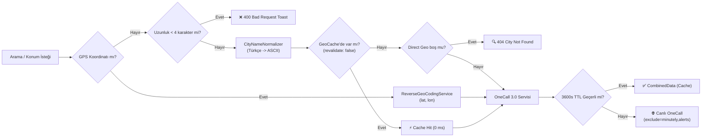
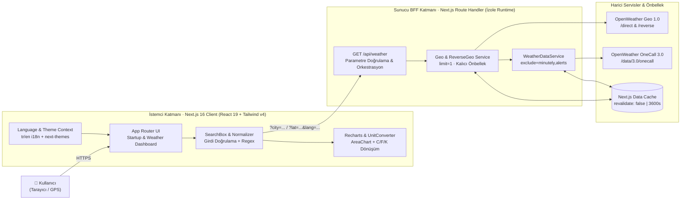
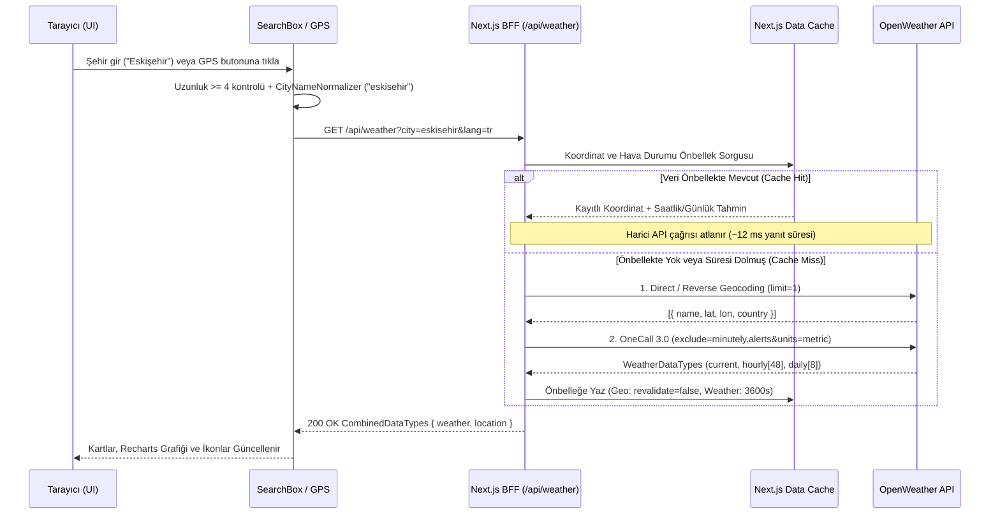
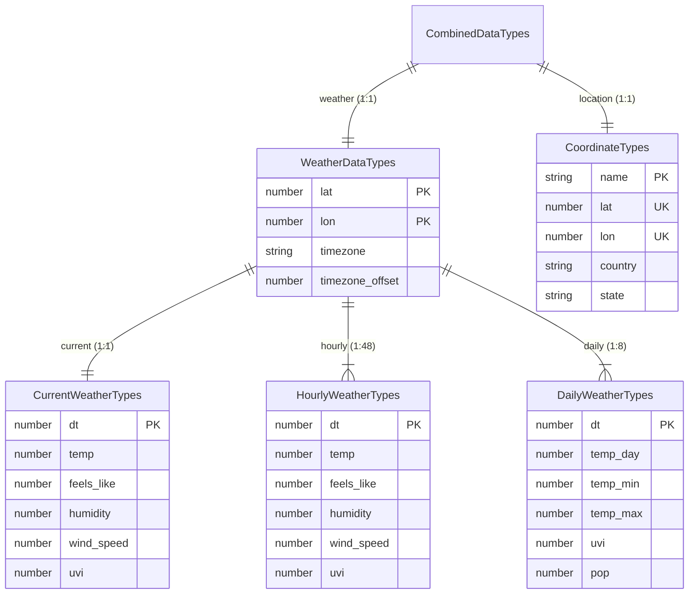

<div align="center">


# Weatherly

### Gökyüzünü keşfetmeye hazır mısın?

**250.000'den fazla şehir için anlık hava durumu metriklerini, 8 günlük detaylı tahminleri ve saatlik sıcaklık trendlerini sıfır gecikmeyle keşfedin.**

<a href="#-özellikler">Özellikler</a>
&nbsp;·&nbsp;
<a href="#-arama-normalizasyon-ve-görselleştirme-motoru">Arama & Görselleştirme Motoru</a>
&nbsp;·&nbsp;
<a href="#-sistem-mimarisi">Sistem Mimarisi</a>
&nbsp;·&nbsp;
<a href="#-mühendislik-detayları">Mühendislik Detayları</a>
&nbsp;·&nbsp;
<a href="#-yerel-kurulum">Kurulum</a>

<br />


</div>

---

## 💡 Neden Weatherly?

Modern hava durumu uygulamalarında son kullanıcı deneyimini ve sunucu maliyetlerini doğrudan etkileyen üç temel mühendislik problemi bulunur:

1. **Aşırı Ağ Yükü ve Kota Tüketimi:** Küresel meteoroloji servisleri (OpenWeather OneCall 3.0 vb.) tek bir çağrıda dakikalık radar dizileri ve uzun fırtına uyarı metinleri dahil **~65.4 KB** büyüklüğünde ham JSON yanıtı döndürür. Her aramada bu verinin filtresiz çekilmesi hem yanıt süresini uzatır hem de API kotalarını hızla tüketir.
2. **Türkçe Karakter ve Geocoding Uyuşmazlığı:** Kullanıcıların yazdığı *"İstanbul"*, *"Eskişehir"*, *"Çanakkale"*, *"Ağrı"* gibi Türkçe karakter barındıran (`İ, ı, ğ, ü, ş, ö, ç`) şehir sorguları, uluslararası Geocoding servislerinde ASCII karşılıklarıyla eşleşmediğinde hatalı sonuç veya `404 Not Found` döndürür.
3. **Mobil Ekranlarda Grafik Karmaşası:** 48 saatlik zaman serisi verisinin dar mobil ekranlarda (`< 640px`) doğrudan çizilmesi, saat ve sıcaklık etiketlerinin üst üste binmesine (label overlapping) yol açar.

**Weatherly** bu problemleri dört katmanlı bir mimariyle çözer:

1. 📍 **Çift Modlu Konumlandırma:** Şehir adıyla arama yapın veya tek tıkla tarayıcının **HTML5 Geolocation (GPS)** koordinatlarını kullanarak bulunduğunuz konumu çözümleyin.
2. 🔤 **Kayıpsız Türkçe Karakter Normalizasyonu (`CityNameNormalizer`):** Girdiler sunucuya gitmeden önce regex tabanlı haritalamayla ASCII standardına dönüştürülür, 4 karakterden kısa hatalı sorgular istemcide kesilir.
3. ⚡ **Çift Kademeli Sunucu Önbelleği ve Yük Budama:** Şehir koordinatları `revalidate: false` ile kalıcı olarak, hava durumu verileri ise `revalidate: 3600` ile 1 saat boyunca önbelleklenir; `exclude=minutely,alerts` filtresiyle ağ yükünde **%72.1 tasarruf** sağlanır.
4. 📈 **Uyarlanabilir Saatlik Trend Grafiği (Adaptive Subsampling):** Recharts tabanlı `AreaChart`, masaüstünde 12 saatlik kesintisiz eğri sunarken mobilde 4 saatlik adımlarla 7 kilit noktayı örnekleyerek (`index % 4 === 0`) görsel karmaşayı sıfırlar.

---

## ✨ Özellikler

| | Özellik | Teknik Karşılığı ve Açıklama |
|:-:|---|---|
| 🛡️ | **Birleşik BFF API Kapısı** | `/api/weather` Route Handler üzerinden konum çözümleme ve hava durumu verilerini tek bir `CombinedDataTypes` (`{ weather, location }`) yanıtında birleştirme; API anahtarını istemciden tamamen gizleme |
| 🔤 | **Türkçe Karakter Normalizasyonu** | `CityNameNormalizer.ts` ile `İ, I, ı, ğ, Ğ, ü, Ü, ş, Ş, ö, Ö, ç, Ç` karakterlerini ASCII karşılıklarına dönüştürme ve boşluk budama |
| 📡 | **HTML5 GPS & Reverse Geocoding** | `navigator.geolocation.getCurrentPosition` ile alınan enlem/boylamı OpenWeather `/geo/1.0/reverse` servisiyle resmi şehir ve ülke adına çevirme |
| 📊 | **Uyarlanabilir Recharts Grafiği** | `WeatherGraph.tsx` içinde masaüstünde 12 saatlik kesintisiz, mobilde 4 saatte bir örneklenmiş 7 noktalı kehribar (`#EAB308`) gradyanlı sıcaklık eğrisi |
| 🗓️ | **8 Günlük Tahmin Izgarası** | Masaüstünde 8 sütunlu tam ızgara, mobilde ise kaydırılabilir (carousel) 4'lü kart yapısıyla haftalık min/max sıcaklık ve yağış olasılığı takibi |
| 🌡️ | **Sıfır Gecikmeli Birim Dönüşümü** | Ek API isteği atmaksızın istemci tarafında **Celsius (°C)**, **Fahrenheit (°F)** ve **Kelvin (K)** arasında anlık matematiksel dönüşüm |
| 🌍 | **Otomatik Çoklu Dil (i18n)** | `LanguageContext` ile `localStorage` ve `navigator.language` tabanlı otomatik **Türkçe / İngilizce** arayüz, yerel gün/saat formatlama |
| 🌗 | **Koyu / Açık Tema (Glassmorphism)** | `next-themes` ve Tailwind CSS v4 ile OLED uyumlu koyu karbon zemin (`#131314`) ve buzlu cam (`backdrop-blur-md`) kart tasarımı |

<br />

<div align="center">
  
  &nbsp;&nbsp;&nbsp;
  
  &nbsp;&nbsp;&nbsp;
  
  &nbsp;&nbsp;&nbsp;
  
  &nbsp;&nbsp;&nbsp;
  
  &nbsp;&nbsp;&nbsp;
  
  <br />
  <sub>Meteorolojik durum ID'si ve gece/gündüz koduna göre dinamik seçilen 18 özel hava durumu ikonu</sub>
</div>

---

## 🧠 Arama, Normalizasyon ve Görselleştirme Motoru

`src/utils/CityNameNormalizer.ts` ve `src/app/api/weather/route.ts` modüllerinde yer alan karar çekirdeği, kullanıcı girdilerini doğrulayarak en düşük gecikmeli ve en az maliyetli veri yolunu seçer:



### 📐 Matematiksel Modeller ve Kenar Durum (Edge-Case) Kuralları

- **Karakter Normalizasyon Fonksiyonu:**
  $$f(s) = \text{trim}\Big(\text{lower}\big(\text{replace}(s, \{ \text{İ}\mapsto\text{i}, \text{I}\mapsto\text{i}, \text{ı}\mapsto\text{i}, \text{ğ}\mapsto\text{g}, \text{ü}\mapsto\text{u}, \text{ş}\mapsto\text{s}, \text{ö}\mapsto\text{o}, \text{ç}\mapsto\text{c} \})\big)\Big)$$
- **İstemci Tarafı Birim Dönüşüm Formülleri (`UnitConverter.ts`):**
  $$T_{\text{F}} = \text{round}\!\left(\frac{9}{5}\,T_{\text{C}} + 32\right), \qquad T_{\text{K}} = \text{round}\!\left(T_{\text{C}} + 273.15\right)$$
- **Mobil Uyarlanabilir Örnekleme (`WeatherGraph.tsx`):**
  $$D_{\text{mobile}} = \big\{\, d_i \in D_{\text{hourly}} \;\big|\; i \equiv 0 \pmod 4 \,\big\}_{i=0}^{24} \implies |D_{\text{mobile}}| = 7 \text{ kilit veri noktası}$$

| Durum / Parametre | Değer / Kural | Sistem Tepkisi ve Mühendislik Gerekçesi |
|---|---|---|
| ✅ `200 OK` | `CombinedDataTypes` | Koordinat çözümlenmiş ve OneCall 3.0 verisi alınmıştır; anlık kart, 8 günlük ızgara ve saatlik grafik güncellenir. |
| ⚠️ `400 Bad Request` | `input.trim().length < 4` | 1–3 harfli eksik aramalar (`"a"`, `"ist"`) sunucuya hiç gönderilmeden istemcide kesilir; API kotası korunur. |
| 🔍 `404 Not Found` | `geoCodingData.length === 0` | Geocoding servisi boş dizi (`[]`) döndürdüğünde OneCall servisine geçersiz koordinat gitmesi engellenir. |
| 🚨 `500 Internal Error` | `!process.env.OPENWEATHER_API_KEY` | Sunucu ortam değişkeni eksikliği veya harici sağlayıcı kesintisi yakalanarak güvenli hata mesajı döndürülür. |

---

## 🏗 Sistem Mimarisi

Weatherly, **Next.js 16 App Router** üzerinde istemci görünüm katmanı ile harici API iletişimini yürüten sunucu vekil (BFF) katmanı birbirinden tamamen izole edilerek yapılandırılmıştır. Tarayıcı hiçbir zaman OpenWeather sunucularıyla doğrudan iletişim kurmaz.



### 📦 Proje Dizin Yapısı

```text
weatherapp/
├── public/                              # 18 adet yüksek çözünürlüklü özel meteorolojik ikon (.png)
└── src/
    ├── app/
    │   ├── api/weather/route.ts         # BFF API Gateway: Geocoding + OneCall orkestrasyonu
    │   ├── layout.tsx                   # ThemeProvider, LanguageProvider ve Toaster kök sarmalayıcı
    │   ├── page.tsx                     # Ana hava durumu paneli ve durum yönetimi
    │   └── StartupPage.tsx              # Karşılama ekranı, arama kutusu ve mevcut konum aksiyonu
    ├── components/
    │   ├── modal/
    │   │   ├── CurrentWeatherCardModal.tsx
    │   │   ├── HourlyWeatherCard.tsx
    │   │   ├── HourlyWeatherCardGrid.tsx # 24 saatlik kaydırılabilir tahmin ızgarası
    │   │   ├── WeatherGraph.tsx         # Recharts AreaChart (Masaüstü 12s / Mobil 7 nokta)
    │   │   └── WeatherModal.tsx         # Escape dinleyicili camlaştırılmış detay modalı
    │   ├── settings/                    # Dil (TR/EN), Tema (Koyu/Açık) ve Birim (C/F/K) ayarları
    │   ├── CurrentWeatherCard.tsx       # Anlık sıcaklık, UV, rüzgar hızı, nem ve hissedilen kartı
    │   ├── DailyWeatherCardGrid.tsx     # 8 günlük hava durumu tahmin ızgarası
    │   └── SearchBox.tsx                # Girdi doğrulamalı ve yükleme kilitli arama bileşeni
    ├── contexts/
    │   └── LanguageContext.tsx          # localStorage ve tarayıcı dili destekli i18n sağlayıcısı
    ├── dicts/                           # tr.json ve en.json dil sözlükleri
    ├── services/
    │   ├── GeoCodingService.ts          # Şehir adından koordinat çözümleme (revalidate: false)
    │   ├── ReverseGeoCodingService.ts   # GPS koordinatından şehir çözümleme (revalidate: false)
    │   └── WeatherDataService.ts        # OneCall 3.0 hava durumu servisi (revalidate: 3600)
    ├── types/                           # WeatherTypes.ts ve CoordinateTypes.ts katı tip şemaları
    └── utils/
        ├── CityNameNormalizer.ts        # Türkçe -> ASCII karakter normalizasyonu
        ├── GetCurrentLocation.ts        # HTML5 Geolocation API sarmalayıcısı
        ├── UnitConverter.ts             # Celsius, Fahrenheit ve Kelvin dönüşüm motoru
        └── WeatherIconSwitcher.ts       # WMO durum ID ve ikon kodu hibrit haritalayıcısı
```

### 🔄 Akıllı Sorgulama ve Önbellek Akışı (Smart Caching)

Aynı şehrin tekrar tekrar aranması durumunda harici API'ye her seferinde gitmek yerine iki kademeli **Next.js Server Data Cache** devreye girer:



### 🗂 Veri Modeli ve TypeScript Şema Mimarisi



---

## 🔬 Mühendislik Detayları

### 🌐 Konum Çözümleme ve Hibrit İkon Haritalama Stratejisi

| Bileşen | Mühendislik Stratejisi |
|---|---|
| **Direct & Reverse Geocoding** | `GeoCodingService` ve `ReverseGeoCodingService`, OpenWeather `/geo/1.0` uç noktalarını `limit=1` parametresiyle sorgular. En yüksek doğruluklu ilk eşleşme (`data[0]`) alınır. Şehirlerin coğrafi koordinatları sabit olduğundan `next: { revalidate: false }` ile **kalıcı olarak** önbelleğe alınır; aynı şehir için ikinci kez dış API kotası harcanmaz. |
| **OneCall 3.0 Hava Servisi** | `WeatherDataService.ts`, çözümlenen koordinatları `exclude=minutely,alerts&units=metric` parametreleriyle sorgular. Yanıt `next: { revalidate: 3600 }` ile **1 saat** boyunca sunucu önbelleğinde tutulur. |
| **Hibrit İkon Haritalayıcı (`WeatherIconSwitcher`)** | Standart OpenWeather ikon kodları (`01d`..`13n`) çisenti ile sağanak yağmuru veya hafif kar ile kar fırtınasını ayırt etmekte yetersiz kalır. `WeatherIconSwitcher` önce WMO meteorolojik durum ID'sini denetler: `300–321` aralığında özel `/drizzle.png`, `602 / 621 / 622` kodlarında ise `/snow_storm.png` varlığına geçiş yaparak toplam **18 özel ikonu** yönetir. |

### ⚡ Hız, Bant Genişliği ve Görselleştirme Optimizasyonları

| Optimizasyon | Uygulanan Teknik | Ölçüm / Boyut | Somut Kazanım |
|---|---|---|:-:|
| **Payload Exclusion** (OneCall 3.0) | `exclude=minutely,alerts` sorgu parametresiyle arayüzde kullanılmayan dakikalık yağış dizisi ve uzun metin uyarıları daha kaynakta kesilir. | `65.4 KB` → `18.2 KB` | **%72.1** daha az veri ve hızlı JSON ayrıştırma |
| **Two-Tier Data Cache** (Next.js 16) | Koordinatlar süresiz (`false`), hava durumu 1 saat (`3600s`) sunucu belleğinde tutularak çift harici HTTP turu ortadan kaldırılır. | `~380 ms` → `~12 ms` | **%96.8** daha düşük yanıt süresi ve kota koruması |
| **Adaptive Subsampling** (Recharts) | 48 saatlik veri masaüstünde `slice(0, 12)` ile 12 saatlik kesit, mobilde ise `filter((_, i) => i % 4 === 0).slice(0, 7)` ile 7 noktaya seyreltilir. | `48 Nokta` → `12 / 7 Nokta` | **%100** etiket çakışması önleme ve akıcı SVG çizimi |

### 🔐 Güvenlik ve Uluslararasılaştırma (i18n)

- **Sunucu Tarafı Anahtar İzolasyonu:** `OPENWEATHER_API_KEY` yalnızca Node.js sunucu çalışma zamanında okunur (`NEXT_PUBLIC_` öneki kullanılmaz); istemci paketlerine veya tarayıcı ağ sekmesine asla sızmaz.
- **Parametre Hijyeni:** Normalize edilen tüm şehir girdileri `encodeURIComponent()` ile kodlanarak URL parametre enjeksiyonu ve bozuk URI hataları engellenir.
- **Çift Katmanlı Dil Algılama:** `LanguageContext` ilk açılışta `localStorage.getItem("app-lang")` kaydını okur; kayıt yoksa `navigator.language.startsWith("tr")` ile tarayıcı dilini algılayarak hem arayüz sözlüğünü (`tr.json` / `en.json`) hem de OpenWeather API `lang` parametresini senkronize eder.

---

## 🧰 Teknoloji Yığını

| Katman | Teknolojiler |
|---|---|
| **Dil & Tip Güvenliği** | TypeScript 5 (Uçtan uca katı tip şemaları) |
| **Çekirdek Çatı (Framework)** | Next.js 16.2.6 (App Router, Route Handlers, Server Data Cache), React 19.2.4 |
| **Arayüz & Stil** | Tailwind CSS v4, `next-themes` 0.4.6, `clsx`, `tailwind-merge` |
| **Veri Görselleştirme** | Recharts 3.8.1 (`ResponsiveContainer`, `AreaChart`, Doğal Eğri & SVG Lineer Gradyan) |
| **İkonografi & Bildirim** | Lucide React 1.16, React Icons 5.6, `react-hot-toast` 2.6, 18 Özel Hava Durumu İkonu |
| **Dış Servisler & Tarayıcı API** | OpenWeather OneCall 3.0 API, OpenWeather Geocoding 1.0 API, HTML5 Geolocation API |

---

## 🛠 Yerel Kurulum

### Gereksinimler

- **Node.js** ≥ 20
- **npm** / **pnpm** / **yarn**
- **OpenWeatherMap API Anahtarı** *(OneCall 3.0 ve Geocoding 1.0 erişimi)*

### Adımlar

```bash
# 1. Repoyu klonlayın
git clone https://github.com/borayrdmc/Weather-App.git
cd Weather-App

# 2. Bağımlılıkları yükleyin
npm install

# 3. Ortam değişkeni dosyasını oluşturun
echo "OPENWEATHER_API_KEY=your_api_key_here" > .env.local

# 4. Geliştirme sunucusunu başlatın
npm run dev
```

Uygulama hazır olduğunda **http://localhost:3000** adresinden erişebilirsiniz.

### Ortam Değişkenleri

| Değişken | Konum | Açıklama |
|---|---|---|
| `OPENWEATHER_API_KEY` | `.env.local` | OpenWeatherMap OneCall 3.0 ve Geocoding 1.0 API anahtarı (**Zorunlu — sunucu tarafında tutulur**) |

### Faydalı Komutlar

```bash
npm run dev      # Geliştirme sunucusunu başlatır (http://localhost:3000)
npm run build    # Üretim (production) derlemesi oluşturur
npm run start    # Üretim sunucusunu başlatır
npm run lint     # ESLint 9 ile kod kalitesi denetimi yapar
```

---

## 🗺 Yol Haritası

- [x] OpenWeather OneCall 3.0 ve Direct/Reverse Geocoding 1.0 entegrasyonu
- [x] `CityNameNormalizer` ile Türkçe karakter normalizasyonu
- [x] HTML5 Geolocation API ile tek tıkla mevcut konum tespiti
- [x] `exclude=minutely,alerts` ile %72.1 veri boyutu optimizasyonu
- [x] Çift kademeli Next.js Data Cache (`revalidate: false` ve `3600s`)
- [x] Recharts ile masaüstü (12 saat) ve mobil (7 nokta) uyarlanabilir sıcaklık grafiği
- [x] Türkçe / İngilizce i18n desteği ve °C / °F / K anlık birim dönüşüm motoru
- [ ] Favori şehirler listesi ve hızlı geçiş çubuğu
- [ ] Hava Kalitesi İndeksi (AQI) ve polen yoğunluğu modülü
- [ ] Şiddetli yağış ve fırtına durumları için Web Push tarayıcı bildirimleri
- [ ] PWA (Progressive Web App) ile çevrimdışı çalışma desteği

---

<div align="center">

[@borayrdmc](https://github.com/borayrdmc) tarafından geliştirildi.

<sub>Bu projeyi beğendiyseniz ⭐ vermeyi unutmayın!</sub>

</div>
